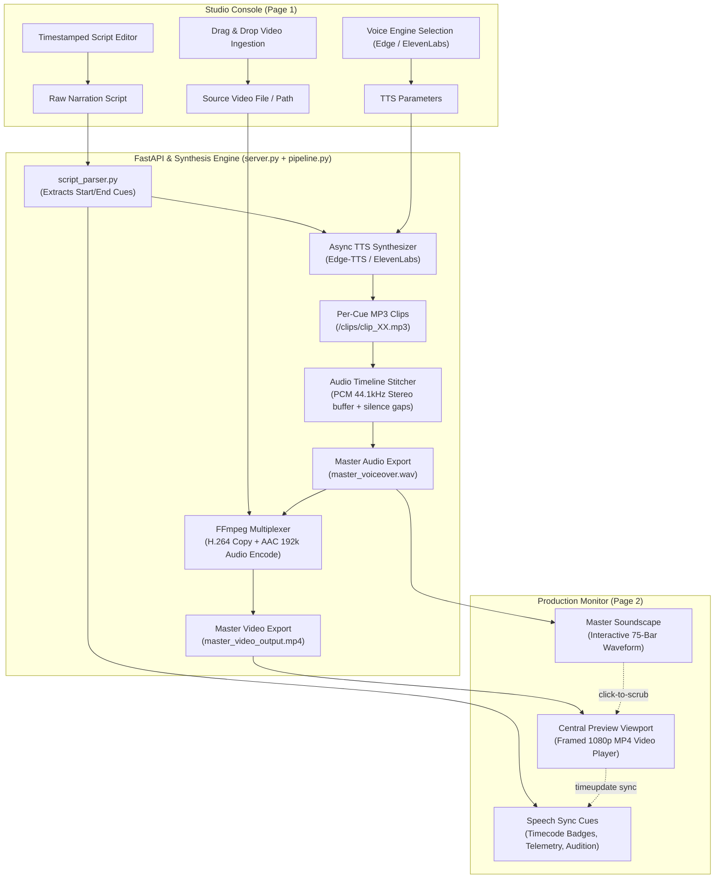

# 🎙️ Emerald Workstation — Professional Voiceover Synthesizer & Video Multiplexer

[](https://fastapi.tiangolo.com)
[](https://github.com/rany2/edge-tts)
[](https://ffmpeg.org)
[](https://python.org)
[](#-design-system--tokens)

**Emerald Workstation** is a commercial-grade, browser-based media production workstation and FastAPI backend for synthesizing timestamped voiceover narrations, generating sample-accurate master audio soundscapes, and multiplexing synchronized video tracks using FFmpeg.

---

## 🏗️ Architecture & Pipeline Workflow



---

## 🌟 Key Features

### 1. Studio & Script Console (Page 1)
- **Source Video Ingestion Deck:**
  - **Drag & Drop Zone:** Interactive drop well supporting MP4, WebM, and QuickTime MOV.
  - **Live Video Preview:** Embedded 16:9 player with instant Blob URL preview, detected filename, format badges, and one-click "🔄 Replace" / "✕ Remove" controls.
  - **Direct Filesystem Path:** Auto-sanitized path input that strips outer quotes and special characters from pasted paths.
- **Timestamped Voiceover Script Editor:**
  - Multi-line textarea for editing timestamped narrations (`0:00 – 0:06`).
  - Clear placeholder examples with timestamp formatting guidelines.
  - One-click "✕ Clear Script" button.
- **Dual Voice Synthesis Engine:**
  - **Free Microsoft Edge Neural Voices:** 6 natural neural voices (Guy, Christopher, Ryan, Jenny, Sonia, William) with zero API keys or rate limits.
  - **ElevenLabs API Integration:** Custom Voice ID and API key configuration drawer.
- **Reference Skeleton Loader (Inspired by `useless_project_temp`):**
  - Rotating dashed outer spinner ring (`spinDashed`).
  - Centered bobbing microphone avatar (`bobIcon`).
  - Dynamic cycling status subtitles with stage updates.
  - 4-stage pipeline stepper: `1. Parse Script` → `2. Neural Voice` → `3. Master Audio` → `4. Video Merge`.
  - Staggered triple bouncing dots and live percentage readout (`0%` → `100%`).

### 2. Production Monitor & Timeline (Page 2)
- **Multi-Track Master Sequencer Bar:**
  - High-precision timecode clock badge (`00:02:45.120`).
  - One-click navigation back to Studio Console.
- **Central Preview Viewport:**
  - Framed 1080p MP4 synchronized video player (`#mainVideoPlayer`).
  - Format badge: `Canvas 1080p @ 60fps`.
- **Master 44.1kHz Stereo Soundscape:**
  - Standalone master audio player (`#mainAudioPlayer`).
  - **Interactive Waveform Visualizer (`#waveformCanvas`):**
    - 75 acoustic envelope speech bars with rounded caps.
    - Two-tone visualization: rich Emerald green (`#107B4F`) for played duration, soft sage (`#C4D9CD`) for unplayed duration.
    - Click-to-scrub seeking: clicking anywhere on the waveform immediately scrubs audio playback.
    - Real-time monospace timecodes (`#audioTimeCurrent`, `#audioTimeTotal`).
- **Speech Sync & Multi-Track Narration Cues (`#segmentsContainer`):**
  - Cue index badges (`Cue #01`, `0:00 – 0:06` in Courier Prime) clickable to seek the video player to that exact timestamp.
  - Full narration text display in high-legibility typography.
  - Telemetry badges: audio clip duration, allocated timeline slot, and calculated gap/headroom (`+0.8s gap`).
  - **Copy Action:** Copies cue narration text to clipboard with instant visual checkmark feedback and toast notification.
  - **Play Clip Action:** Auditions individual speech segments on demand (`playCueClip`).
  - **Live Playback Synchronization:** Cues automatically illuminate with emerald accent borders as the video playhead advances through their time range.
- **Export Controls:**
  - **Export Master (FFmpeg H.264/AAC):** One-click download of the multiplexed MP4.
  - **Export Master Audio (.wav):** Download of the standalone 44.1kHz stereo master track.

### 3. Top Sticky Header & Navigation
- **Emerald WORKSTATION Branding:** High-contrast logo with Retro Floral display typography.
- **Segmented Control Navigation:** Studio and Production Monitor tabs with live synced cue counter badge (`#tabCueBadge`).
- **Session Reset Button:** Resets all inputs, video players, and script console with confirmation prompt and toast alert.

---

## 📁 Directory Structure & File Inventory

```
Video-audio-merging-and-text-to-speech/
├── fonts/                              # Local font assets
│   ├── Retro Floral.ttf                # Brand display typography font
│   └── Retro Floral.otf
├── index.html                          # Complete Emerald Workstation single-page application
├── server.py                           # FastAPI REST server & static media file router
├── pipeline.py                         # Asynchronous audio synthesis & FFmpeg video pipeline
├── script_parser.py                    # Timestamp parser and cue segment builder
├── requirements.txt                    # Python runtime package dependencies
├── start.bat                           # Windows batch launcher (starts server & opens browser)
├── start.ps1                           # Windows PowerShell launcher
└── README.md                           # Documentation & user manual
```

---

## 🚀 Quick Start Guide

### Prerequisites
- Python 3.9 or higher
- Windows, macOS, or Linux
- Internet connection (for Microsoft Edge neural voice synthesis or ElevenLabs)

### 1. Installation
Clone or navigate to the project directory and install the required dependencies:

```powershell
pip install -r requirements.txt
```

### 2. Launch the Application

#### Option A: One-Click Windows Launcher
Double-click **`start.bat`** (or execute **`start.ps1`** in PowerShell). This starts the FastAPI server and automatically opens the interface in your default browser.

#### Option B: Terminal Command
Run directly via Python:
```powershell
python server.py
```
Then open **`http://127.0.0.1:8080/`** in your browser.

---

## 🎙️ Timestamped Script Syntax Guide

The parser automatically detects timestamps formatted as `MM:SS – MM:SS` or `M:SS - M:SS` preceding each narration block:

```text
0:00 – 0:06
Welcome to our product showcase. An organizer signs in and submits a new proposal.

0:06 – 0:12
The platform administrator reviews the submission and approves it.

0:12 – 0:17
The team configures event visibility, timeline deadlines, and track categories.
```

- **Silence & Padding:** If the audio duration is shorter than the allotted time slot, the pipeline automatically inserts silence up to the next timestamp.
- **Overrun Protection:** If speech exceeds the slot, subsequent clips dynamically offset to maintain timeline integrity.

---

## 🔌 REST API Endpoints

| Method | Endpoint | Description |
| :--- | :--- | :--- |
| `GET` | `/` | Serves the Emerald Workstation production interface (`index.html`). |
| `POST` | `/api/generate` | Starts synthesis & video multiplexing. Accepts JSON body (`script_text`, `voice`, `elevenlabs_key`, `elevenlabs_voice_id`, `video_path`). |
| `GET` | `/api/progress` | Returns real-time pipeline status and percentage (`{"status": "...", "progress": 0.75}`). |
| `POST` | `/api/upload-video` | Handles multipart video file uploads from the Studio drag-and-drop zone. |
| `GET` | `/fonts/{font_name}` | Serves local typography files (e.g. `Retro Floral.ttf`). |
| `GET` | `/clips/{clip_name}` | Serves individual audio segment clips. |

### Generation Request Payload Example
```json
{
  "script_text": "0:00 – 0:05\nHello and welcome to the demonstration.\n\n0:05 – 0:10\nHere is how the system performs.",
  "voice": "en-US-GuyNeural",
  "video_path": "C:\\path\\to\\source_video.mp4"
}
```

### Generation Response Example
```json
{
  "success": true,
  "total_duration": 10.0,
  "segments": [
    {
      "id": 1,
      "label": "0:00 – 0:05",
      "start": 0.0,
      "end": 5.0,
      "duration": 3.8,
      "text": "Hello and welcome to the demonstration.",
      "clip_url": "/clips/clip_01.mp3"
    }
  ],
  "master_audio_url": "/master_voiceover.wav",
  "video_url": "/master_video_output.mp4"
}
```

---

## 🎨 Design System & Tokens

All interface styling is centralized via CSS custom properties in `:root`:

| Token | Value | Description |
| :--- | :--- | :--- |
| `--bg-primary` | `#F4F7F5` | Crisp light sage-gray studio canvas background |
| `--bg-panel` | `#FFFFFF` | Pure white cards and surfaces |
| `--bg-elevated` | `#EDF4F0` | Soft mint-tinted wells, inputs, and drop zones |
| `--accent-primary` | `#107B4F` | Rich Emerald green for active tabs, CTAs, and playheads |
| `--accent-hover` | `#0D6E44` | Deep emerald for hover and active pressed states |
| `--accent-mint` | `#D1F4E2` | Pastel mint for telemetry pills, cue gap tags, and waveforms |
| `--text-primary` | `#112A1F` | Deep dark forest pine for razor-sharp legibility |
| `--text-secondary` | `#4D665A` | Slate sage for subheadings, labels, and secondary metadata |
| `--border-color` | `#DCE8E1` | Precision hairline borders for cards and inputs |

---

## 🛠️ Troubleshooting & Technical Notes

- **FFmpeg Engine:** Emerald Workstation automatically accesses the embedded FFmpeg binary bundled via `imageio-ffmpeg`. No manual system PATH installation or system restart is required.
- **Audio Output Standard:** The master voiceover is stitched directly into uncompressed **44.1kHz 16-bit Stereo PCM WAV** format for professional mixing and lossless export.
- **Video Multiplexing:** Audio is multiplexed into the source video stream using `-c:v copy` (lossless video passthrough) and `-c:a aac -b:a 192k` (high-fidelity stereo audio track).
- **Temporary Uploads & Git:** All uploaded media files, generated clips, and output video/audio binaries are ignored via `.gitignore` to keep repository size lean and under Git limits.

---

## 📄 License & Credits

- **Author / Lead Developer:** kryPsis
- **Copyright:** © 2026 Emerald Workstation. All rights reserved.
